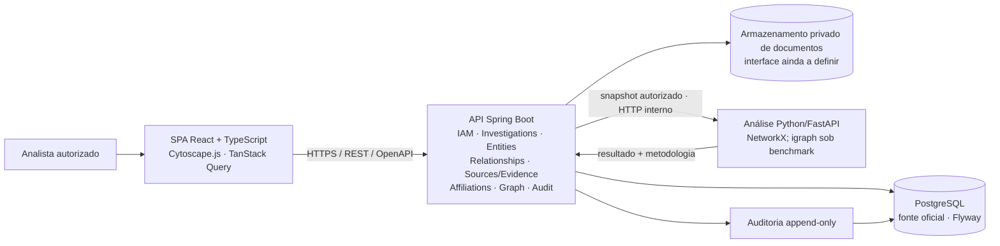
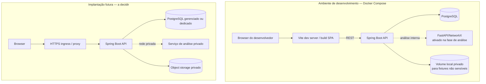

# Arquitetura inicial do NEXUS

**Status:** proposta para validação. **Escopo:** arquitetura lógica e contratos iniciais; não representa funcionalidades implementadas.

## Inspeção do repositório

Na inspeção inicial, o repositório continha somente `README.md` (9 bytes, título “Graphic”). Não foram encontrados código-fonte, manifests, dependências, testes, migrações, configurações de infraestrutura ou documentação adicional. A árvore Git estava limpa na branch `main`. Portanto, não há implementação existente a preservar e nenhuma tecnologia instalada foi inferida.

## Proposta

Começar com um monólito modular Java/Spring Boot para identidade, investigações, catálogo e dados investigativos, persistidos em PostgreSQL. O backend controla transações, autorização, validação e auditoria; o frontend acessa somente contratos REST, nunca o banco. O esquema inicial separa catálogo global de entidades e observações/relações pertencentes a cada investigação.

Análise em Python/NetworkX ficará em um serviço interno independente, iniciado na fase de grafos, pois a stack define Java para o domínio transacional e Python para algoritmos. A separação permite conter dependências e consumo de CPU e evoluir/medir algoritmos sem acoplar o ciclo de vida do domínio. Seu custo é mais uma implantação, contrato e fronteira de segurança; até essa fase não será criada infraestrutura fictícia. PostgreSQL segue como fonte oficial. Não há justificativa inicial para Neo4j.

Zustand não é necessário até que exista estado compartilhado de interface que não pertença ao estado remoto (TanStack Query) nem ao estado local de tela. O monólito terá limites de pacote e dependências definidos desde o início; não haverá extração antecipada de microserviços.

## Diagrama de componentes



O bloco de documentos ainda é uma decisão em aberto: no desenvolvimento poderá haver adaptador local; produção exige armazenamento privado, controle de acesso, retenção e estratégia de integridade. Documentos não devem ser expostos por URL pública.

## Diagrama de implantação proposto



O diagrama de produção é conceitual, não escolha de provedor ou topologia aprovada. Compose local não representa alta disponibilidade nem política de backup de produção.

## Limites dos módulos e dependências

- **Identity & Access:** usuário, sessão/identidade, papéis e concessões por investigação. Não é dono de dados de investigação.
- **Investigations:** ciclo de vida e metadados do caso; ponto de autorização contextual.
- **Entities:** identidade global da pessoa/organização e seus atributos tipados; vínculo de visibilidade com investigações.
- **Relationships:** afirmações investigativas sobre pares de entidades, tipo, direção, validade e qualificação. São registros próprios da investigação, não arestas globais.
- **Sources & Evidence:** metadados de fonte e afirmações/evidências que a sustentam, incluindo origem, localização, qualificação e integridade de artefato.
- **Affiliations:** especialização temporal de relação de vínculo (ex.: filiação partidária), sem duplicar uma aresta paralela independente.
- **Graph:** consulta autorizada e projeção de subgrafo; não expõe entidades JPA. Retorna DTOs estáveis.
- **Analytics:** orquestra snapshots/solicitações e persiste referência a resultados e metodologia; algoritmo isolado no worker Python.
- **Audit:** eventos append-only para ações relevantes; não é mecanismo de autorização.

Dependências permitidas: módulos de domínio podem depender de contratos compartilhados pequenos e serviços de aplicação explícitos. Graph consulta interfaces de leitura de Entities/Relationships/Evidence. Analytics recebe snapshot DTO já autorizado e devolve resultado versionado. Nenhum módulo acessa repositórios JPA de outro módulo diretamente; comunicação entre módulos via serviços/fachadas de aplicação. Evitar um pacote `common` genérico.

## Contratos de comunicação (proposta v1)

REST JSON com prefixo `/api/v1`, OpenAPI publicado pelo backend, UUIDs, datas RFC 3339 e paginação por cursor onde listas possam crescer. Erros seguem `application/problem+json` com código estável e `traceId`. Toda rota investigativa valida concessão do usuário e o escopo da investigação no servidor.

Rotas centrais sugeridas:

- `GET/POST /investigations`; `GET/PATCH /investigations/{id}`.
- `GET/POST /investigations/{id}/entities`; `GET/PATCH /investigations/{id}/entities/{entityId}`.
- `GET/POST /investigations/{id}/relationships`; filtros por tipo, entidade e intervalo temporal.
- `GET/POST /investigations/{id}/sources` e `/evidence`.
- `GET /investigations/{id}/graph?center={entityId}&depth=1&limit=...&from=...&to=...` retorna subgrafo limitado com `nodes`, `edges`, `nextCursor` e metadados de truncamento.
- `POST /investigations/{id}/analyses` cria análise com algoritmo, parâmetros e escopo; `GET /investigations/{id}/analyses/{analysisId}` consulta estado/resultado.

DTO de nó: `id`, `kind`, `label`, `attributes` permitidos, `investigationEntityId`. DTO de aresta: `id`, `source`, `target`, `type`, `directed`, `validity`, `epistemicStatus`, `sourceCount`. Não enviar documento ou conteúdo sensível no payload do grafo. Endpoints e nomes são propostas; a OpenAPI executável será criada junto da implementação.

Contrato API-backend ↔ análise: chamada de rede privada com identidade de serviço. `GraphSnapshot` contém `schemaVersion`, `investigationId`, `snapshotAt`, nós e arestas minimizados/autorizados, recorte e filtros. `AnalysisRequest` contém `analysisId`, `algorithm`, `parameters`, `methodologyVersion` e snapshot. Resposta contém estado, resultados tipados, avisos, duração e versão da implementação. Sem acesso direto do serviço de análise ao PostgreSQL ou armazenamento de documentos. Autenticação mútua, limites e tratamento de timeout/repetição serão especificados antes da fase 3.

## Estrutura de diretórios sugerida (após validação)

```text
.
├── apps/
│   ├── web/                       # React + TypeScript + Vite
│   ├── api/                       # Spring Boot; módulos por domínio
│   └── graph-analysis/            # FastAPI/NetworkX, introduzido na fase 3
├── infra/
│   └── docker-compose.yml
├── docs/
│   ├── adr/
│   ├── ARCHITECTURE.md
│   ├── DATA_MODEL.md
│   ├── GRAPH_ANALYSIS.md
│   ├── SECURITY.md
│   └── ROADMAP.md
└── .env.example                  # somente nomes/valores não secretos
```

Dentro de `apps/api`, organizar por módulo (`investigations`, `entities`, `relationships`, `sources`, `graph`, `analytics`, `audit`, `identity`) com camadas `domain`, `application`, `infrastructure` e `api` somente onde agreguem separação real. Não criar diretórios vazios em antecipação.

## Riscos e ambiguidades a resolver

1. **Identidade e login:** provedor externo (OIDC) ou autenticação local? Impacta sessões, provisionamento e operação.
2. **Compartilhamento de entidades:** uma identidade global facilita deduplicação, mas pode revelar existência de pessoa em outro caso. A API deve impedir enumeração e evitar resposta diferente que confirme vínculo não autorizado; decidir se atributos são globais, versionados ou copiados por investigação.
3. **Vocabulário de fatos:** documentado/reportado/alegado/não confirmado são status epistêmicos diferentes de verdadeiro/falso. Definir transições, autoria e se evidências podem contradizer a mesma afirmação.
4. **Fontes vs. evidências:** fonte (publicação/origem) e evidência (trecho/artefato que sustenta uma afirmação) precisam de política de armazenamento, citação, direitos de acesso e hash.
5. **Histórico:** definir correção por nova versão/evento versus sobrescrita, retenção e retificação/eliminação. Audit não substitui versionamento de domínio.
6. **Datas incompletas:** definir precisão de datas (dia/mês/ano desconhecidos), intervalos abertos, fuso e distinção entre validade no mundo e data de registro.
7. **Pesos:** centralidades não precisam de peso; shortest path ponderado só será habilitado quando houver atributo com unidade, direção de custo e interpretação documentadas.
8. **Execução de análises:** sincronismo, fila, cancelamento, limites de memória, política de persistência e expiração de resultados ainda precisam de decisão baseada em volume/uso.
9. **Arquivos e implantação:** armazenamento de evidências, classificação, backup, recuperação, residência de dados e ambiente-alvo não foram especificados.
10. **Métricas/escala:** sem volume estimado de casos, usuários, nós/arestas, concorrência ou metas de latência, não se deve fixar shard, banco de grafos nem topologia de produção.

## Critérios para seguir à implementação

Validar a arquitetura modular e o modelo de entidade compartilhada; fechar pelo menos as questões de autenticação, segregação de entidades, status epistêmicos, arquivos e política de histórico. Em seguida, criar esqueleto mínimo, Compose, migração inicial e CI, preservando as decisões aprovadas em ADRs atualizados.
