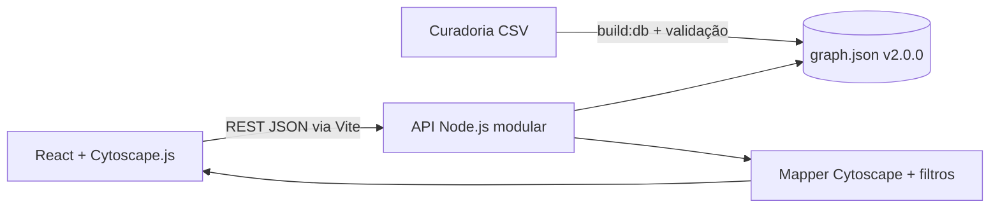

# Arquitetura GRAPH — esquema v2.0.0

## Componentes vigentes

- **Frontend:** React/Vite e Cytoscape.js.
- **API única modular:** servidor HTTP Node.js nativo, organizado por investigação, catálogo/contexto de entidades, relações/evidências/fontes e análise.
- **Persistência de execução:** `data/graph.json`.
- **Curadoria e ingestão:** CSVs versionáveis em `data/curadoria/`; `scripts/build-db.mjs` valida o esquema sem dependências externas e recompila o JSON.
- **Projeção visual:** `src/api/cytoscapeMapper.js` aplica filtros e produz `{ elements: { nodes, edges } }`, hidratando evidências e fontes nas arestas.

## Contrato da rede

O catálogo de entidades é global; `investigation_entities` registra participação e papel contextual por investigação. Relacionamentos são contextualizados pela investigação e apontam a IDs de entidades. Fontes são objetos independentes; cada evidência associa uma fonte e uma relação com página/localizador, trecho e nota. O compilador impede arestas sem evidência e rejeita referências cruzadas entre investigações.

Status epistêmico e desfecho jurídico/administrativo são campos separados. Valor e unidade existem apenas para grandezas objetivas; degree, Brandes betweenness, harmonic closeness, componentes e BFS seguem não ponderados.

## Migração da demonstração

A antiga investigação fictícia foi mantida como investigação à parte. Sua fonte e evidências estão marcadas como sintéticas, sem representar documentos ou fatos reais. A investigação CVM é uma base de curadoria fornecida e vinculada à fonte primária indicada; a classificação legal de multas também tem evidência normativa própria.

## Limites

Node/JSON permanece a escolha local atual. O processo de build sobrescreve `data/graph.json` com os CSVs; portanto, alterações de runtime devem ser levadas à curadoria antes de recompilar para não serem descartadas. Não há microsserviços, banco relacional, autenticação ou concorrência multiusuário nesta versão.
