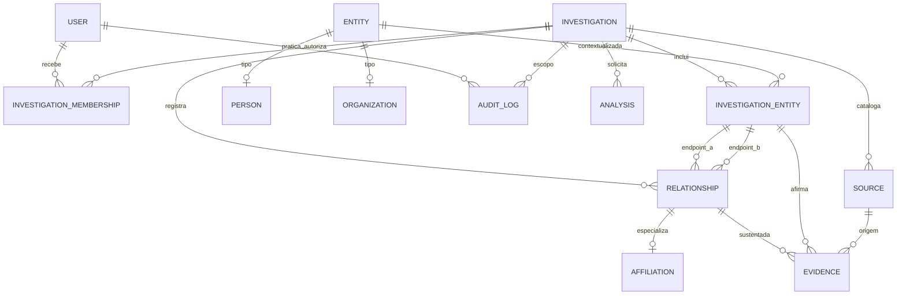

# Modelo de dados inicial

**Status:** proposta lógica; nomes e tipos finais dependem da implementação e das decisões de identidade/privacidade.

## Princípios

- PostgreSQL é a fonte oficial; chaves primárias UUID, timestamps UTC, migrações Flyway.
- Distinguir catálogo de identidade (`entity`) do contexto investigativo (`investigation_entity`). A relação e a interpretação de um fato pertencem à investigação.
- `Person` e `Organization` compartilham identidade (`Entity`) e têm tabelas 1:1 tipadas. Não usar tabela única de atributos esparsos nem JSON genérico para campos centrais.
- A existência de um catálogo compartilhado não concede visibilidade: toda consulta resolve e autoriza `investigation_entity` antes de revelar dados.
- Temporalidade de validade (`valid_from/to`) é diferente do tempo de registro (`created_at`, histórico). Intervalos abertos são permitidos; início posterior ao fim é inválido.
- `epistemic_status` qualifica o conhecimento da afirmação; não é um score de culpa nem probabilidade numérica.

## ER inicial

## Entidades e regras

- **User:** principal autenticado. Identificador externo OIDC ou credencial local depende da decisão de IAM; guardar apenas hash forte de senha se autenticação local for adotada.
- **Investigation:** `id`, `name`, `description`, `status`, `created_at`, `created_by`. Sem dados de um caso particular embutidos no código.
- **InvestigationMembership:** `investigation_id`, `user_id`, `role`, timestamps; unicidade por par. Papel global não substitui a concessão por investigação.
- **Entity:** `id`, `kind` (`PERSON`/`ORGANIZATION` inicialmente), `created_at`, `created_by`. Identificador não deve ser enumerável; não colocar atributos sensíveis de caso no catálogo global.
- **Person:** `entity_id`, nome/nomes alternativos e atributos tipados aprovados. **Organization:** `entity_id`, nome/nomes alternativos, forma/categoria e atributos aprovados. Evitar identificadores pessoais sensíveis por padrão.
- **InvestigationEntity:** `id`, `investigation_id`, `entity_id`, rótulo contextual opcional, notas restritas, `created_at`, `created_by`; unique `(investigation_id, entity_id)` se só houver uma representação por entidade/caso. Esta é a porta de leitura para endpoints do caso.
- **Relationship:** `id`, `investigation_id`, `from_investigation_entity_id`, `to_investigation_entity_id`, `type`, `directed`, descrição, `valid_from`, `valid_to`, `epistemic_status`, autor e timestamps. Ambos endpoints devem pertencer à mesma investigação; sem self-edge salvo tipo que o permita explicitamente. Uma relação sempre representa uma afirmação contextual, não um fato automaticamente comprovado.
- **Source:** `id`, `investigation_id`, tipo, citação, URL/caminho privado, data de publicação/acesso, metadados permitidos, hash de artefato quando aplicável. Fonte externa pode deixar de estar disponível; armazenar cópia exige política jurídica/operacional.
- **Evidence:** `id`, `investigation_id`, `source_id`, alvo polimórfico controlado (relação ou entidade contextual, por tabelas de associação tipadas preferencialmente), locator/trecho, `epistemic_status`, nota de interpretação, hash/localizador do artefato, `created_by`, timestamp. Preferir tabela `relationship_evidence` e `entity_evidence` em vez de FK polimórfica sem integridade.
- **Affiliation:** especialização 1:1 de Relationship, `relationship_id`, papel/cargo e categoria de filiação. Partido/organização é o outro endpoint. Usa os mesmos intervalos, fontes e histórico da relação, sem duplicar período.
- **Analysis:** `id`, `investigation_id`, algoritmo, parâmetros JSON versionados e validados por algoritmo, `methodology_version`, versão do código, filtros/snapshot, estado, timestamps, usuário solicitante e referência privada do resultado. Não guardar saída derivada sem informar snapshot que a produziu.
- **AuditLog:** `id`, ator, investigação opcional, ação, tipo/ID do objeto, timestamp, `trace_id`, metadados mínimos antes/depois conforme política. Append-only pela aplicação; acesso restrito e proteção contra alteração administrativa definida operacionalmente.

## Evidência, qualificadores e histórico

Vocabulário inicial de status: `DOCUMENTED`, `REPORTED`, `ALLEGED`, `UNCONFIRMED`, com descrição de uso aprovada e possibilidade de evolução. Status não é automaticamente uma escala ordenável. Evidências múltiplas podem divergir; não consolidar divergências em um único booleano.

Versões de objetos investigativos devem ser preservadas (tabelas de histórico/versionamento ou eventos de auditoria com cópia suficiente) para reconstruir “o que era conhecido” na execução de uma análise. A estratégia física e regras de correção/eliminação são questões abertas. Não usar log de aplicação como único histórico.

## Restrições de integridade a implementar

- FK e `CHECK` para tipos, status e `valid_from <= valid_to`.
- Garantir endpoint e evidência no mesmo escopo investigativo via chave composta/FK ou transação de domínio, não somente validação do frontend.
- Unicidade de memberships e tipos de catálogo conforme decisão de domínio.
- Índices por investigação, endpoints, tipo e validade; índices adicionais só com consultas e medições.
- Evitar `ON DELETE CASCADE` em evidência/auditoria. Preferir arquivamento e retenção explícitos.
- Valores quantitativos ponderados devem carregar unidade, semântica e direção de custo em atributos tipados e metodologia; não inventar pesos para tipos qualitativos.
